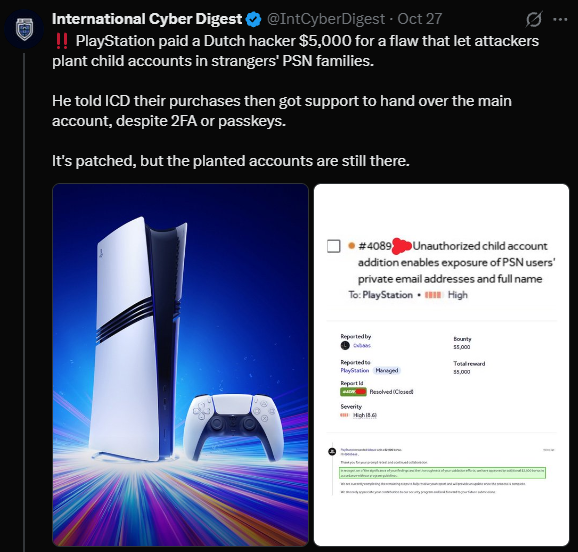
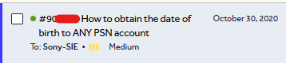
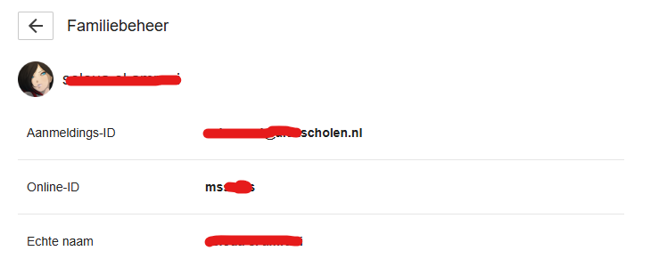
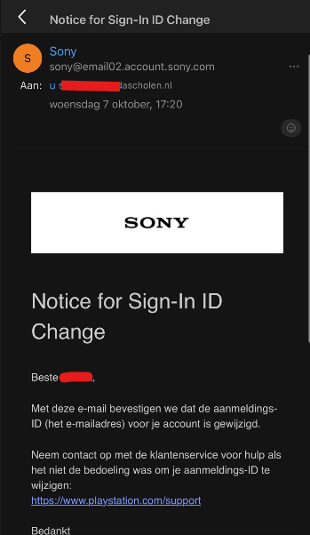
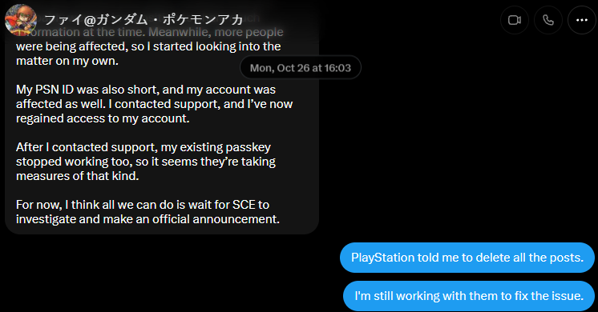
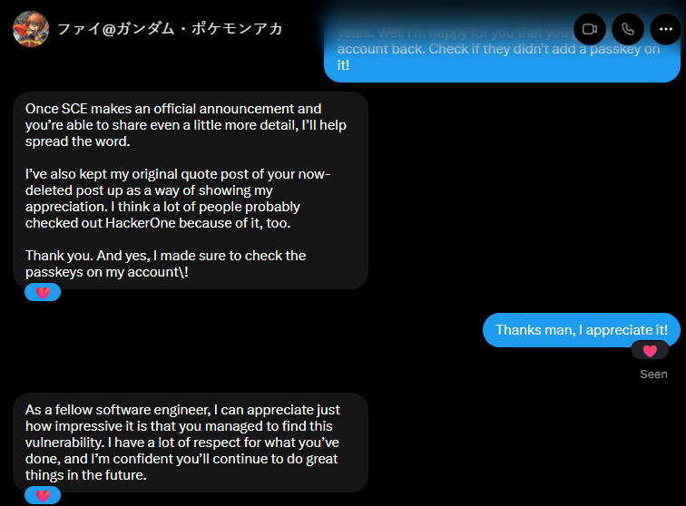
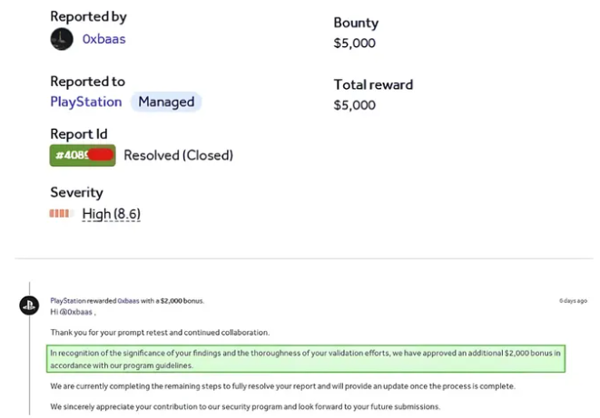
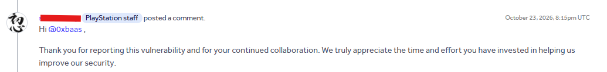

In early October I discovered a zero-day in PlayStation Network (PSN) that allowed me to add a child account to someone else's PlayStation family without their knowledge or approval. What initially looked like an information disclosure issue turned into something much bigger: I managed to chain it into a full account takeover (ATO), even with 2FA or passkeys enabled.

Sony patched the vulnerability just three days later and awarded me a **$5,000 bug bounty**. But that wasn't the end of the story. A few weeks later, reports of compromised PSN accounts started spreading across Japan, with affected players discovering unauthorized child accounts linked to their families.

I've been reporting security vulnerabilities to PlayStation since its bug bounty program launched in 2020. One of my earlier findings allowed me to retrieve the date of birth associated with any PSN account, which PlayStation was still using for account recovery checks in Japan at the time.

*An earlier PlayStation vulnerability report, resolved in 2020.*

Back in September 2026, with all the hype around GTA 6, I noticed quite a few hackers taking another look at PlayStation's security. Several vulnerabilities had recently been reported, mostly involving kernel and usermode exploits. Seeing all that activity made me want to jump back in myself. I wanted to focus on PlayStation Network rather than the console itself. 

After a couple days I found something which could be **chained into something very crazy.**

## Testing the zero-day on my wife's account
I first tested the vulnerability on my wife's PSN account to see how the attack would play out against a real account. I was able to add a child account to her PlayStation family without her having to approve anything. The only email she received was about updated terms and conditions. Nothing in that email told her a child account had been added.

From the child account, I could see her full name, email address and other sensitive account information. The changes to her family were happening without any warning on her side.

*The child account being able to read a lot of sensitive information*

PlayStation Family Management is supposed to let parents manage their children's accounts, set spending limits and configure parental controls. Yet I could add a child account without the family manager's approval, while she couldn't even remove it herself. She had to contact PlayStation Support.

And to be fair, Family Management isn't exactly something people check regularly. Without any notification, most users wouldn't even realize an unknown child account had been added to their family.

## From child account to full account takeover
I kept looking at what the family relationship allowed. Purchases made through a child account appeared in the family manager's transaction history. Combined with weaknesses in PlayStation's account ownership checks, this gave me a way to take over her account.

I successfully took over my wife's PSN account. PlayStation changed the sign-in email address, leaving her locked out of her own account.

*Sony's confirmation that my wife lost access to her PlayStation account during the ATO.*

What surprised me was that her 2FA didn't stop me. I later found out that **passkeys wouldn't stop the same attack chain either.**

_I can't disclose the exact account recovery steps and sensitive technical details at PlayStation's request._

If the family manager had a credit card linked to their PSN account and child account spending was enabled, an attacker could also make purchases using the victim's payment method.

This made the vulnerability more than just an information disclosure issue. It could also lead to unauthorized purchases, even before taking over the account entirely.

## Did it work outside Europe?
After the first takeover, I wanted to see if the vulnerability worked in other regions. I created test accounts using a VPN from North America, Singapore and Japan.

**Every account was vulnerable to the full ATO chain.**

There was also no effective rate limiting, making automated attacks against **large numbers of accounts possible.**

## Passkeys could provide lifetime persistence after an ATO

To test whether an attacker could maintain access after account recovery, I registered a passkey on my wife's account. She then recovered it through PlayStation Support, which restored her original sign-in email.

**But my passkey still worked.** I could sign in and change her email address again. Because the passkey remained linked to the PSN account, an attacker could maintain access even after recovery **unless she explicitly removed the passkey herself through account settings.**

## The backdoors were still there after the patch

Sony patched the vulnerability on October 8, just three days after my discovery. However, the unauthorized child accounts I'd added during testing **were still linked to the families**.

I warned PlayStation that the patch hadn't removed these existing connections and urged them to investigate potential abuse and remove any unauthorized child accounts.

## Then reports of mass exploitation started coming from Japan

A few weeks after the patch, reports of hacked PSN accounts began spreading across Japan. One victim discovered several unauthorized child accounts after checking his Family Management settings. Others reported the same, sometimes finding the maximum of six child accounts.

I noticed that many victims had short or rare PSN usernames. Since PSN launched first in Japan and North America in 2006, I suspected those attackers were mainly targeting those old accounts with valuable usernames.

One Japanese warning from @BA20090112 went viral, reaching over **3.3 million views** on X:

<blockquote class="twitter-tweet" data-theme="dark"><a href="https://twitter.com/BA20090112/status/2114335260926410785">View the Japanese warning on X</a></blockquote>

Another user showed what had appeared in their family:

<blockquote class="twitter-tweet" data-theme="dark"><a href="https://twitter.com/gorry5/status/2114584609145188857">View the Family Management report on X</a></blockquote>

Manga artist Imigimuru also posted about being affected:

<blockquote class="twitter-tweet" data-theme="dark"><a href="https://twitter.com/imigimuru/status/2114565109528039445">View Imigimuru's post on X</a></blockquote>

One report that stood out was from a writer at [AKIBA PC Hotline!](https://akiba-pc.watch.impress.co.jp/docs/news/news/2151333.html), who had been affected himself. He found five child accounts he hadn't added, **despite using a passkey and a sign-in email address which he only uses for PSN.** He had to contact PlayStation Support to get them removed.

The number of child accounts made me suspect that the attacks were automated. **Seeing these reports also made me wonder how big this hack could have become if the vulnerability hadn't been patched.**

Japanese gaming sites including [4Gamer](https://www.4gamer.net/games/990/G999027/20261026038/), [Game*Spark](https://www.gamespark.jp/article/2026/10/26/174092.html) and [GAME Watch](https://game.watch.impress.co.jp/docs/news/2151226.html) covered the incidents. Some reports referred to suspicious activity from early October, before the story gained attention later that month.

After the reports went viral in Japan, the story started spreading internationally. I began seeing similar reports from PlayStation users in Europe and the United States.

Another user on [Reddit](https://www.reddit.com/r/psn/comments/1x7l1ga/five_unauthorized_accounts_added_under_my_main/) reported finding five unauthorized child accounts linked to his PSN account despite using a passkey. Other players reported losing access to their accounts entirely.

The issue was now getting attention well beyond Japan, with accounts like Pirat Nation and International Cyber Digest sharing the story.

<blockquote class="twitter-tweet" data-theme="dark"><a href="https://twitter.com/Pirat_Nation/status/2115151932448735324">View Pirat Nation's post on X</a></blockquote>

I received messages from affected users as well, particularly from Japan. Several told me they couldn't remove the unknown child accounts themselves and had to go through PlayStation Support.

After the story went viral, PlayStation finally started removing the malicious child accounts. The child accounts I had used in my own tests were permanently banned as well. This was the cleanup I had been asking for since the patch.

## Why I decided to warn affected players
Because PlayStation hadn't removed the backdoors from my own test accounts, I was worried the same thing would happen to those actual victims. Even after recovering their accounts, those unknown child accounts could still be linked to their families and the ATO chain could be repeated.

I decided to share a high-level explanation of the issue so affected players knew what to check. I urged them to contact PlayStation Support about unfamiliar child accounts and remove any passkeys they didn't recognize. PlayStation later asked me to take those posts down. 

I later posted a warning on X, reminding affected players to check for unauthorized passkeys after recovering their accounts:
<blockquote class="twitter-tweet" data-theme="dark"><a href="https://twitter.com/baas/status/2114712737360085281">View my PlayStation security warning on X</a></blockquote>

A Japanese tech enthusiast who had been hacked himself came across my original posts about unauthorized child accounts, which I'd taken down shortly after PlayStation asked me to remove them. He decided to investigate further and eventually found my HackerOne profile, where he noticed the $5,000 PlayStation bounty.

After connecting the dots, he wrote a detailed post explaining the situation and encouraging Japanese players to check their Family Management settings. He also reached out to me through DMs, telling me that his own account had been taken over and that he'd managed to recover it through PlayStation Support.

I asked him to spread the word about unauthorized passkeys as well, especially for players who had already recovered their accounts. He checked his own passkeys and told me that his previous passkey had stopped working after recovery.

## Sony confirmed the vulnerability
On November 5, [PSXNAVI published an email from Sony](https://psxnavi.com/games/93935/) to affected PlayStation users. Sony confirmed that a flaw in its **Add Family Member** feature had allowed third parties to link child accounts without the family manager's permission. Sony said it detected the issue on October 7 and completed the fix on October 8.

Sony also confirmed that the family manager's name and email address could be viewed through these accounts. It said it was investigating affected users and removing child accounts added through the vulnerability.

## Reporting it to PlayStation and the $5,000 bounty
I reported the all of my research through PlayStation's HackerOne program. My report was rated **High (8.6)** and was later resolved.

*My PlayStation HackerOne report, rated High (8.6), resolved and awarded a $5,000 bounty.*

I also continued helping PlayStation after the patch, sharing additional observations from my research and suggesting checks they could add to verify the fix and find unauthorized child accounts that were still linked. On October 23, a PlayStation staff member thanked me again for reporting the issue and for our continued collaboration.

PlayStation awarded me a **$5,000 bounty** for the Family Management finding.

## Timeline

| Date | Event |
|---|---|
| October 5, 2026 | I discovered the zero-day |
| October 7, 2026 | Sony says it detected the issue |
| October 8, 2026 | Sony completed the fix, but previously added child accounts remained on my test accounts |
| October 19, 2026 | $5,000 bounty awarded |
| October 23, 2026 | PlayStation thanked me for continued collaboration |
| Late October 2026 | Reports spread across Japanese social media |
| November 5, 2026 | Sony's email to affected users was published |

## References
- [Sony's notification, published by PSXNAVI](https://psxnavi.com/games/93935/)

- [TweakTown: PSN account hijacks and passkey persistence](https://www.tweaktown.com/news/114348/psn-account-hijacks-researcher-warns-attacker-added-passkeys-survive-password-changes/index.html)

- [Cyber Kendra: PSN Family Child Account Hack](https://www.cyberkendra.com/2026/10/psn-family-child-account-hack.html)

- [AKIBA PC Hotline!: A writer describes unauthorized child accounts on his own PSN account](https://akiba-pc.watch.impress.co.jp/docs/news/news/2151333.html)

- [My HackerOne profile](https://hackerone.com/0xbaas)

